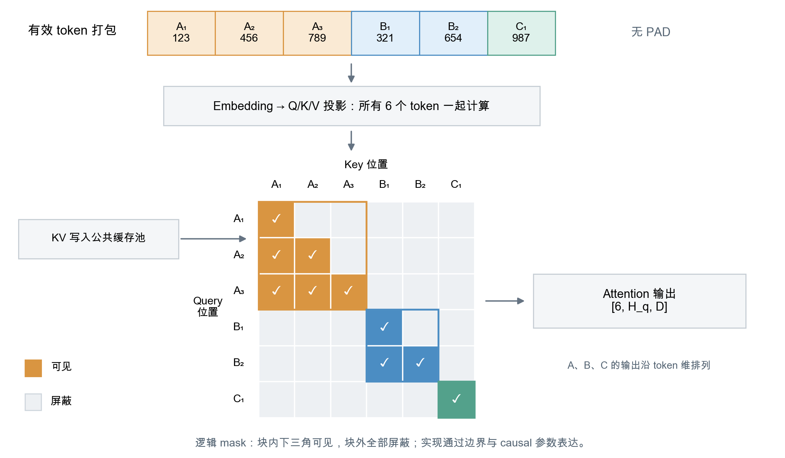
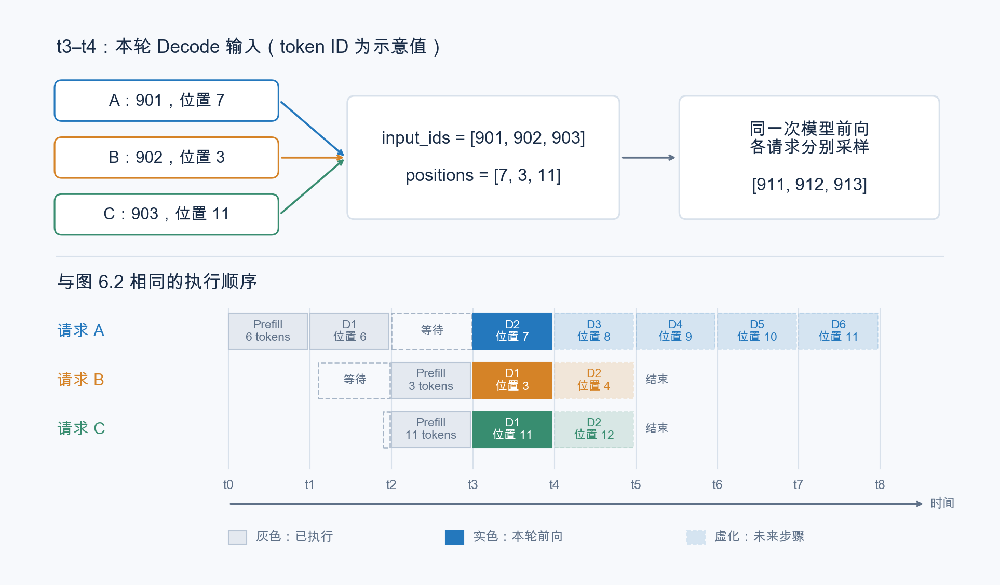

# 第 6 章 连续批处理与调度

上一章中，我们为推理引擎加上了 API Server，让推理引擎从一段用完就扔的程序升格为一个常驻内存的 HTTP 服务。上一章的第五节，我们提到了这个 API Server 需要支持多人同时访问，同时处理多个人请求（但是不考虑如何用 gpu 计算它们）也被我们称为“并发”。但是正如上一章第五节末尾所言，http 并发只是在逻辑层面处理接收不同的请求，这不等于并行执行多个请求的前向推理。

想要并行执行，最直接的做法就是把多个请求的解码后的 tokens 拼成一个 batch，然后以 batch 为单位进行前向计算，这样可以大幅增加 GPU 利用率，这也被我们称为批处理。而如何调度并发消费的用户请求，来让它们更加高效地被组织成用于执行批处理的 batch，并保证状态互不干扰，就是本章需要详细讨论的内容了。

## 1 本章学习目标

读完本章后，你应该能够解答如下的问题：

- 解释 API Server 并发和批处理并行的区别（它们分别解决了什么问题）；
- 区分服务整体的输出吞吐量（token/s）与单用户生成速度（token/s/user），理解整体吞吐量提高不一定意味着每位用户的生成速度都提高；
- 说明 Prefill batch 和 Decode batch 如何组织输入、计算 Attention 并生成或复用 KV Cache；
- 结合后台调度循环，解释请求如何逐轮加入、保留和退出 batch，以及 batch 变化后如何继续访问各自的 KV Cache；
- 理解 mini-sglang 的 Prefill 优先策略，以及 token 预算、请求槽位和 KV Cache 容量如何限制本轮工作；

## 2 从并发请求到单次批处理

### 2.1 用批处理提高系统吞吐

上一章中，API Server 已经能够在 A 等待生成结果时接收 B，并根据请求标识，将两人的结果分别送回各自的连接。但这只解决了服务层如何管理多个请求的问题，从程序层面支持多个用户同时请求我们的 mini-sglang API 服务。但是这并不意味着，我们的 GPU 会同时处理这些请求的 tokens，默认情况下，最为朴素的调度方式仍然是先计算请求 A 的前向，自回归完成后，返回结果给 A 用户，然后再去计算 B。

我们不妨看一个例子。

假设现在我们的 http 服务在短时间（比如 10 秒）内同时接收到了三个请求 A，B，C。我们的模型在对这些请求的 messages 进行前向的耗时有长有短，可能 A 的耗时最长（A 的 messages 可能是 computer use 帮你打明日方舟日常），B 和 C 的耗时最短（可能就是问一问杭州或者上海明天的天气）。我们在上一章完成的 API Server 会并发处理这三个请求的处理和调度，至少这么做会让发送这三个请求的用户在体感上觉得自己发送的大模型调用请求确实在被我们的推理引擎“处理”。

但是实际上，不做任何优化的最为朴素的调度模式下，推理引擎会顺序执行这三个请求的编码后的 tokens 的前向推理，如图 6.1 所示。

<div align="center">
  
  <p><em>图 6.1 并发接入与逐条推理的区别（未启用批处理的假设场景）</em></p>
</div>

图中可以看到，请求的处理和消费确实是并发的，但是由于实际让 GPU 执行推理时，前向推理是一个个来的，那么我相信，用户 C 的体验会非常糟糕，用户 C 的首 token 延迟（TTFT）等于用户 A 和用户 B 前向推理的总耗时。这不禁会让用户 C 在发送第一个请求后就立刻联系客服要求取消 code plan 的订阅。哦不，我的朋友，这很不好。

如果你很熟悉 PyTorch，我想大概能立刻想到优化方案：既然大模型的一次前向本质就是一堆的线性层和 matmul，那么我们把 A，B，C 三个用户的请求塞到一起不就能并行计算了吗？毕竟在模型算子角度，这三次请求本质就是三个不断执行的若干个线性层计算，且每一次执行线性层计算时，batch_size 都是 1。那么我们想办法把不同请求同时塞进去，让 batch_size 等于 3，不就能实现并行同时推理这三个请求了吗？这样，我们就可以充分发挥 GPU 并行计算的能力，服务更多的用户。

具体的一个调度示意图如图 6.2 所示：

<div align="center">
  
  <p><em>图 6.2 并发接入与批处理推理</em></p>
</div>

除此之外，笔者还拿 qwen3.8 27b 在 8 张 H200 上用 sglang 的默认配置跑了一下 bs=1 和 bs=16 去调度消费 100 条请求的情况，重复运行三次取平均结果，下面是运行结果：

| 统计量 | BS=1 | BS=16 |
| --- | ---: | ---: |
| tokens/s | 157.26 | 1740.94 |
| tokens/s/user，不含排队 | 166.38 | 129.66 |
| TTFT | 80.85 秒 | 5.84 秒 |
| 完成 100 条请求的平均耗时 | 162.79 秒 | 14.71 秒 |

可以看到批处理主要优化的是全部请求的延迟和吞吐，这恰好对应了我们在 [第 5 章 Benchmark 入门](https://datawhalechina.github.io/zero-to-sglang/ch/part1/%E7%AC%AC5%E7%AB%A0_Benchmark%E5%85%A5%E9%97%A8.html#_3-2-%E5%90%9E%E5%90%90%E7%B1%BB%E6%8C%87%E6%A0%87) 里的两类指标。

> 延迟和吞吐恰好对应高性能计算分析中的 $\alpha - \beta$ 模型。

批处理想法很不错，但是其中有大量的技术细节需要在本章中讨论：

- 如何编排每个环节才能让多个用户的请求在 PD 分离的框架下被并行计算？
- KV Cache 怎么管理？
- 假设我们最大 batch_size 为 16，但是有人一下子打过来 1000 条请求（比如友商友善蒸馏我们的模型），我们要如何处理它们的调度优先级？

在 mini-sglang 中，这些部分都通过 Scheduler 模块来进行负责，具体代码实现我们会在本章的代码走读环节进行。本章更多从概念角度为阁下答疑解惑。

让我们一个个来吧。

> 趣闻：deepseek r1 刚刚开源那会儿，很多云服务商都部署了开源版本的 deepseek r1，但是运行成本居高不下，一直达不到 deepseek 对外声称的 30% 毛利率，导致大量质疑 deepseek 数据造假的帖子层出不穷。后来 deepseek 揭秘了 30% 毛利率的 infra 工程技巧，其中最为关键的技巧就是批处理技术，根据笔者当年掌握的业界情报，峰值 batch size 至少为 8 的批处理推理引擎才能让 deepseek r1 的部署回本。想要达到 30% 的利润率，需要更大的 batch size 和更加精细化的 infra 调优。

### 2.2 从前台消息循环到后端调度循环

上一章中，前台 `FrontendManager` 通过一个 `while` 循环持续接收后端结果并返回给用户。后台的调度同样可以理解为一个 `while` 循环，它每一个 iter 需要解决这么几件事：

1. 接收请求
2. 选出一个 batch
3. 执行前向
4. 更新状态并返回结果

我们先用下面的伪代码建立一个基本的讨论模型：

```python
# 概念伪代码，省略 CPU/GPU 重叠执行等实现细节。
while True:
    receive_requests()           # 接收新请求和取消消息；无工作时等待，有工作时不等凑批。
    batch = select_next_batch()  # 选择这一轮要处理的请求，组装成一个 batch。
    if batch is None:
        continue

    prepare_batch(batch)         # 准备本轮输入，以及 KV Cache 的读写位置。
    outputs = forward(batch)    # 执行本轮模型计算。
    update_requests(outputs)    # 更新各请求的进度，处理已完成请求的资源。
    send_results(outputs)       # 将有效生成结果返回给对应用户。
```

可以看出重点其实就是第二步了，如何根据当前 API Server 接收并积累的请求去选出当前哪些请求会被组装成一个 batch，弄明白这一点，我们也就大致理解了批处理的流程。

**检查一下：** 为什么图 6.2 中请求 B 到达后需要等待一阵子？

### 2.3 同一个 batch 的请求必须具有相同 phase

所以，批处理的核心就在于如何组装一个 batch。组装一个 batch 并送入 gpu 并行推理并非像某些小学生拾人牙慧写的 PyTorch 代码一样，直接把请求编码后的 tokens 序列补上 padding，然后直接扔到 `forwards` 函数里面去前向。还记得我们前文引入的 KV Cache 吗？利用历史 KV 的方式不同，Prefill 与 Decode 也就对应两种不同的执行行为。这里先讨论计算阶段的划分，部署层面的 PD 分离则进一步把它们交给不同执行实例。

PD 分离的存在让我们在组装 batch 的时候需要 “因地制宜” 了 —— 至少 prefill 和 decode 不能再被当成一模一样的工作，闭着眼睛塞到一起。前者一次可能要计算成百上千个 token，给这一段输入建立 KV Cache；后者只需要计算当前的一个新 token，再读出历史 KV，赶紧把下一个 token 返回给正在等回答的用户。

你可能会问：它们用的不是同一份模型权重吗，直接把 tensor 拼起来一起算不就行了？为啥不这么搞 PD 并行混推？线性层确实可以这么干，但是并非如同直觉一般会让系统的整体性能最优。并且从代码架构的角度，prefill 和 decode 阶段的差异和对硬件资源的要求本就不一样，KV Cache 行为也不一样，贸然放在一个 batch 中推理不仅不一定会改善系统性能，反而需要破坏代码已有的架构，引入不必要的噪音和复杂度。

因此，我们有必要给当前组装 batch 的算法添加一条不证自明的准则：**同一个 batch 中的请求，本轮必须使用相同的 phase**。要么这一批做 Prefill，要么这一批做 Decode。（投机解码那一章，我们会引入其他的 phase）

当前 mini-sglang 的 `select_next_batch` 采用 Prefill 优先策略：

```python
def select_next_batch():
    # 只从 Prefill 待处理请求中组批；检查 token 预算、请求槽位与 KV 容量。
    batch = prefill_manager.schedule_next_batch(prefill_budget)
    if batch is not None:
        return batch  # 本轮只执行 Prefill，运行中的 Decode 请求保留状态。

    # 无法组成可执行的 Prefill batch，再从运行中的请求中组成 Decode batch。
    return decode_manager.schedule_next_batch()
```

对应图 6.2，A 先独自完成 Prefill，再执行一轮 Decode；B、C 随后到达，在下一次组装 batch 时，由于 B 和 C 的 prefill 都没有执行，我们优先调度 prefill 请求，所以我们选择组装 B 和 C 的 prefill 作为 batch，于是选择器返回 `Prefill[B, C]`。A 这一轮没有被选中，但历史 KV 继续保留。等到下一轮时，由于没有 prefill 请求，就把 A，B，C 的 decode 请求组装成 batch 继续推理，让三条请求各自往前走一步。

这样一来，可以看到系统中就发生了两处不同类型的并行：

- B 和 C 的 prefill 并行执行了。
- A，B，C 的部分 decode 并行执行了。

这样可以更加充分地使用 GPU 的计算资源和 IO 带宽，提高系统的吞吐，而且之前顺序执行时致命的超长 TTFT 问题也得到了解决。

接下来，我们就分别看看 Prefill batch 和 Decode batch 中，输入和 KV Cache 应该怎样组织。至于系统中两类请求同时等待时，这一轮应该选择哪个 phase，则放到第 3 节的调度部分讨论。

### 2.4 prefill batch

prefill batch 把多条请求尚未计算的输入组织到一次前向中。假设 A、B、C  在这一轮被调度为一个 prefill batch，它们的文本编码后分别得到 `[123, 456, 789]`、`[321, 654]` 和 `[987]`，假设此时都没有可复用的历史 KV。mini-sglang 会把它们的有效 token 打包到一起：

```python
input_ids = [123, 456, 789, 321, 654, 987]  # [6]，依次属于 A、B、C
```

Embedding 后得到的 tensor 的 shape 为 `[6, d_model]`，这 6 个 token 一起参与后续的线性层计算。调度器同时准备每个 token 在原请求中的位置、各请求的序列边界，以及本轮 K/V 将写入的缓存位置。进入每一层 Transformer 后，一起计算 Q/K/V，按头组织后，Q 的形状为 `[6, H_q, D]`，新 K、V 各为 `[6, H_kv, D]`，其中 `H_q`、`H_kv` 分别是 Query 和 KV 的头数，`D` 是每个头的维度。K 应用位置编码后，与 V 一起成为这一层需要保存的 KV Cache 数据。

这份 K/V 沿 token 维依次对应 A、B、C，因此这一层为三条请求生成的缓存，逻辑上可以分为：

| 请求 | K 的形状 | V 的形状 |
| --- | --- | --- |
| A | `[3, H_kv, D]` | `[3, H_kv, D]` |
| B | `[2, H_kv, D]` | `[2, H_kv, D]` |
| C | `[1, H_kv, D]` | `[1, H_kv, D]` |

上述表格的这些 tensor 就是需要写入 kv cache 的 tensor。然后继续参与后续的 Attention 计算，直到得到这一层 transformer 的输出。

值得一提的是，**A，B，C 的 KV 长度不同，不代表计算 Attention 时必须打个 `for i in range(3)` 循环去计算 Attention，也不需要先把 KV 补齐成相同长度。** mini-sglang 底层通过 FlashInfer 来调用底层的 Attention 内核从而完成并行化的 batch 的 Attention 计算。我们可以先把变长请求的批量 Attention 看成一个黑盒，由底层 Attention 算子组织并行计算。

NVIDIA cuDNN 的 Attention 和华为 CANN 的 ATB 算子都提供了变长批量 Attention 的能力。以 CANN 为例，这里的普通 Prefill 对应 `SelfAttentionOperation` 的 `PA_ENCODER` 模式，输入接口可简化表示为：

```text
query：  [6, H_q, D]
key：    [6, H_kv, D]
value：  [6, H_kv, D]
seqLen： [3, 2, 1]，分别对应 A、B、C
mask：   因果掩码，按各请求的长度应用
```

输出形如 `[6, H_q, D]` 的 tensor。这里展示的是 CANN 普通 Prefill 场景的接口；mini-sglang 的实际 Backend 调用留到代码走读中介绍。

除了加入 batch 维度后 Attention 计算的差异外，causal mask 也有点差异。如图 6.3 所示。组成 batch 后的 causal mask 从过去的下三角变为了分块矩阵的下三角。

<div align="center">
  
  <p><em>图 6.3 Prefill 的 token 打包与逻辑注意力掩码</em></p>
</div>

当然，这些底层也都做了支持和优化，mini-sglang 通过请求边界和 causal 参数表达这一约束，无须实际构造完整的 `[6, 6]` mask。

合并头维并经过输出投影后，恢复为 `[6, d_model]`，继续后面的 MLP 和 Transformer 层。完整 Prefill 结束时，LM Head 取各请求最后一个输入位置的隐藏状态，得到 `[3, vocab_size]` 的 logits，再分别采样得到首个输出 token。各层已经写入的 KV 则保留在缓存池中，供后续 Decode 使用。

### 2.5 decode batch

普通 decode batch 则让每条请求各提供一个新 token，在同一次前向中分别预测下一个 token。三条请求的输入的 tensor shape 为 `[3, 1]`，Embedding 后为 `[3, 1, d_model]`；mini-sglang 将本轮有效 token 打包后，对应 `[3, d_model]`。调度器同时准备各请求的序列位置、历史长度和 KV Cache 地址映射。

进入每一层 Transformer 后，三条请求的当前 token 一起做 Q/K/V 投影。按头组织后，Q 的形状为 `[3, H_q, D]`，新 K、V 各为 `[3, H_kv, D]`。**Embedding 和这些投影都不需要读取历史 KV，真正读取缓存的是后面的 Attention。** 关于每层保存什么，以及如何写入新 K/V、用当前 Q 查询已有 K/V，可以回看第 4 章 KV Cache 的讨论。

Decode 时，各请求可访问的上下文长度也可能不同。假设 A、B、C 原有的 KV 长度分别为 7、3、11，写入本轮新 K/V 后，各请求参与 Attention 的逻辑形状如下：

| 请求 | 当前 Q | 包含本轮 token 的 K、V | Attention 输出 |
| --- | --- | --- | --- |
| A | `[1, H_q, D]` | 各为 `[8, H_kv, D]` | `[1, H_q, D]` |
| B | `[1, H_q, D]` | 各为 `[4, H_kv, D]` | `[1, H_q, D]` |
| C | `[1, H_q, D]` | 各为 `[12, H_kv, D]` | `[1, H_q, D]` |

表中的 KV 形状表示各请求逻辑上可以访问的数据，不代表底层单独分配或复制了三个连续张量。Decode 也使用前面介绍的 Attention 内核实现批量化并行计算。Attention 输出仍为 `[3, H_q, D]`。

合并头维并经过输出投影后，恢复为 `[3, d_model]`，再继续后面的 MLP 和 Transformer 层；每层读取各自的 KV Cache。最终 LM Head 得到 `[3, vocab_size]` 的 logits，分别采样得到三条请求的下一个 token。

因此，三条请求可以处于不同的生成进度，却共享一次 Decode 前向；各请求的注意力计算仍保持独立。如图 6.4 所示，A、B、C 本轮分别处理位置 7、3、11 的 token，完全可以放进同一个 decode batch。

<div align="center">
  
  <p><em>图 6.4 不同进度的请求共享一次 Decode 前向</em></p>
</div>

batch 的成员和排列可以变化，但每条请求的历史状态仍然独立保留。可能有的读者读到这里会有一定的疑问：“当前的图 6.4 中为什么组装的 decode batch 是连续的 [A,B,C]，即 t3 时刻的 decode batch 就是 [A,B,C]，t5 时刻的 decode batch 仍然是 [A,B,C]，有没有可能中途由于什么原因 [A,B,C] 的 batch 被别的请求插队打散了呢？比如变为 [D,A,B] 呢？“ 这是一个很好的问题，因为这个问题就从批处理引申到了连续批处理（毕竟要考虑时序上的关系了）。我们会在下一节对这个问题加以解答。

**检查一下**：和 batch_size = 1 相比，batch_size > 1 的批处理的 PD 阶段分别有什么不同和相同的地方。

## 3 调度循环中 batch 的成员如何变化

### 3.1 每轮前向之后重新选择请求

上一节中，我们了解了一下要如何组织一次 PD 分离架构下 batch 一次性计算多次不同请求的 token 生成自回归。从而从形式上提升了我们系统的吞吐。

但是正如我们上一节末尾留下的问题一下，我们现在还需要知道每一次组装 prefill/decode batch 时，要如何基于上一次 batch 的请求组合选择这一次的请求组合。比如我们在同一时刻接受到 5 条不同的请求 A，B，C，D，E，但是我们设置的最大 batch size 只有 2，那么当我们在 $t$ 时刻调度了 $[A_{\text{decode}}, B_{\text{decode}}]$ 后，$t+1$ 时刻会不会调度 $[B_{\text{decode}}, D_{\text{decode}}]$，还是仍然调度 $[A_{\text{decode}}, B_{\text{decode}}]$ 呢？

把目光放回 2.2 的 `while` 循环这个基础的调度模型里面，想要解答上面的疑问，其实只需要弄清楚 `select_next_batch` 这个函数内部在调度 prefill 和 decode 的 batch 时具体是如何根据历史调度记录选择当前需要调度的请求就行了。

我们把选择器展开成下面的概念伪代码。它每轮先尝试组装 Prefill batch，无法组成可执行的 Prefill batch 时，再选择 Decode：

```python
# 概念伪代码，具体实现留到代码走读中展开。
def select_next_batch():
    batch = prefill_manager.schedule_next_batch(prefill_budget)
    if batch is not None:
        return batch
    return decode_manager.schedule_next_batch()
```

这两个方法面对的请求集合不同：前者从尚未完成 Prefill 的等待请求中接纳本轮工作，后者让已经进入运行集合的请求继续生成。它们依据的是之前各轮留下的请求状态。

### 3.2 Prefill：从等待请求中接纳本轮工作

`prefill_manager.schedule_next_batch` 按等待顺序取出尚未完成 Prefill 的请求，将本轮 token 预算内的输入组成 batch：

```python
# 概念伪代码，资源检查和具体状态维护留到代码走读中说明。
def schedule_prefill_next_batch(token_budget):
    batch = []
    for req in waiting_requests:
        if token_budget <= 0 or not resources_allow(req):
            break

        inputs = take_unprocessed_inputs(req, limit=token_budget)
        batch.append((req, inputs))
        token_budget -= len(inputs)

    update_waiting_requests(batch)  # 未完成的分块请求留待后续处理
    return Batch(batch, phase="prefill") if batch else None
```

这里的预算限制输入 token 总数，而不是请求数。比如预算为 5，A、B 分别有 3、4 个待处理 token，本轮就可以处理 A 的 3 个和 B 的前 2 个；B 剩余的输入在后续 Prefill 中继续处理，完整 Prefill 后才能进入 Decode。请求槽位、KV 容量等检查统一放在 `resources_allow` 中；如果本轮没有选出请求，就返回 `None`，由外层选择器尝试 Decode。

### 3.3 Decode：让运行中的请求继续生成

`decode_manager.schedule_next_batch` 面对的是已经进入运行集合、仍需生成的请求。相比 Prefill，它不需要重新接纳请求或切分输入，而是选出全部运行请求，每条推进一步：

```python
# 概念伪代码，运行集合由请求状态更新逻辑维护。
def schedule_decode_next_batch():
    if not running_requests:
        return None

    requests = sorted(running_requests, key=lambda req: req.uid)

    # 每条请求提供一个 token，历史上下文通过 KV Cache 访问
    return Batch(requests, phase="decode")
```

当前 mini-sglang 按 `uid` 排列运行请求，但这个排序只是确定 batch 的排列顺序，不是在比较谁更应该得到执行机会。只要运行集合非空，就全部选入本轮 Decode batch；如果为空，则返回 `None`。

因此，假设 `uid_A < uid_B`，当前只有 A、B 正在运行，两者都未结束或取消，且没有新成员加入，那么下一轮选择 Decode 时仍然会得到 `[A, B]`，不会因为“轮到 D 了”就换成 `[B, D]`。D 需要先获准进入、完成 Prefill，并加入运行集合，才会参与后续 Decode。

回到 3.1 假设的最大 batch size 为 2，如果这个容量上限已经被 A、B 占满，D 就要等待接纳机会，而不是挤走其中一条。实际的请求容量和资源限制如何设置，我们在代码走读中说明。

### 3.4 请求如何加入和退出运行集合

每轮计算推进请求的进度，随后更新等待和运行集合。这个过程可以概括为：

```python
# 概念伪代码，省略 CPU/GPU 重叠执行和缓存回收策略。
def update_requests(batch, outputs):
    for req in batch.requests:
        advance_progress(req, outputs)

        if finished_or_cancelled(req):
            remove_from_queues(req)
            release_resources(req)
        elif prefill_finished(req):
            remove_from_waiting(req)
            running_requests.add(req)
        # Prefill 尚未完成的请求继续等待；已有 Decode 请求继续留在运行集合。
```

例如 A、B、C 正在 Decode，D 到达且资源允许接纳，就可能出现：

```text
Decode [A, B, C]
Prefill [D]          # A、B、C 保留状态和 KV，等待后续执行
Decode [A, B, C, D]  # D 完成 Prefill 且仍需生成，加入运行集合
```

如果 C 在此期间结束或被取消，后续 Decode batch 就可能成为 `[A, B, D]`。这是 C 退出、D 加入的结果。当前 mini-sglang 不会为了接纳 D 而抢占仍在生成的 C。

batch 的成员和排列发生变化，也不需要重算或搬迁已有请求的完整 KV：每条请求仍通过自己的映射访问缓存。新请求加入无须等待原来整批请求全部生成完，这就是调度循环中连续更新 batch 的过程。

## 4 这一轮选择哪个 phase，接纳多少请求

### 4.1 Prefill 优先如何影响已有请求

系统中可以同时有等待 Prefill 的新请求和正在 Decode 的请求，但当前实现每轮只选一个 phase 组成执行 batch。例如 A 正在生成，B、C 刚到达，选择器需要决定先继续 A 的 Decode，还是处理 B、C 的 Prefill；没有被选中的请求保留状态和已有 KV，等待后续调度。

按 3.1 的选择器，只有无法组成可执行的 Prefill batch 时，才转向 Decode。

这解释了图 6.2 中两种不同的等待。B、C 在 A 的 D1 已提交后到达，图中假设它们在下一次收集消息时都已准备好，因此共同参与下一轮 Prefill；B 等的是调度机会，不是在主动等待 C 凑批。而 t2 到 t3 期间，A 的 Decode 暂停，是因为本轮优先执行 B、C 的 Prefill。A 仍在运行集合中，历史 KV 也继续保留，这和将 A 移出运行集合是两回事。

图 6.2 忽略了 CPU/GPU 重叠调度的细节，表示一种可能的执行顺序，而不是固定时间表。这里讨论的是同一后端内两个计算阶段的安排，不要求将 Prefill 与 Decode 部署在不同 GPU 上。

### 4.2 接纳新请求时也要考虑已有请求

3.2 中的资源检查并非只看“眼下还能塞多少 prompt”。接纳检查还需要计入运行中请求后续生成所需的空间，再判断能否加入新请求。因此，某条请求即使本轮 Prefill 很短，也可能因为后续输出空间不足而继续等待。

这也是 Prefill 方法可能返回 `None` 的原因：等待列表非空，不代表当前有能力接纳其中的请求。此时选择器仍可转向 Decode，推进已有请求；请求结束后释放的资源，则让后续接纳成为可能。

### 4.3 有工作就执行，不等待 batch 凑满

当前 mini-sglang 没有“等待固定时间，直到 batch 凑满或超时再执行”的机制。系统空闲时会阻塞等待消息；已有工作时，则收集通道中已经到达的消息，并尝试组成下一批计算。即使只有一条请求，只要满足执行条件，也可以独自组成 batch。

对应图 6.2，若下一次收集消息时只有 B，且资源允许，就可以先处理 B，无须等 C 到达。容量和预算是本轮执行的上限，不是每一轮必须凑够的数量。

## 5 怎样评估调度效果

### 5.1 整体吞吐量与单用户生成速度

2.1 的实验已经说明，batch 变大后，整体 token/s 可以明显提高，但 token/s/user 不一定提高。调度效果需要同时看系统在单位时间内产出了多少 token，以及每个用户实际等了多久、生成得多快，不能只用 batch 大小或 GPU 利用率判断。

### 5.2 请求等待与 Prefill 对 Decode 延迟的影响

新请求排队等待接纳，会增加 TTFT；已有请求等待 Prefill batch 执行，则会增加相邻输出 token 之间的间隔。评估时既要观察新请求的首 token 延迟，也要观察生成中的 TPOT 或 token 输出间隔，才能看清 Prefill 优先策略的影响。

### 5.3 token 预算与 KV 占用的取舍

提高 Prefill token 预算，可以让一轮处理更多输入，但也可能让正在等待的 Decode 请求更久得不到执行。接纳更多运行请求有助于扩大 Decode batch，同时也会占用更多 KV 容量。具体取值需要结合输入长度、输出长度和到达流量，通过吞吐与延迟指标一起评估。

## 6 总结与测试题

### 6.1 课程总结

本章从 API Server 的并发接入出发，说明了 Prefill batch 和 Decode batch 如何组织多条请求的前向计算。批量计算时，token 可以打包在一起，但请求边界、位置和缓存映射保证各自的上下文保持独立。

回到调度循环，mini-sglang 优先尝试按等待顺序和资源预算组建 Prefill batch；无法组成可执行的 Prefill batch 时，再选择全部运行中的 Decode 请求。请求在迭代之间加入、保留和退出，KV Cache 则按请求跨迭代保留。评估这一过程，既要看整体吞吐，也要看新请求等待和已有请求的生成延迟。

### 6.2 测试题

1. API Server 和连续批处理分别解决了什么场景的什么问题？

2. 为什么 mini-sglang 中不支持不同 phase 的请求放在同一个 batch 进行前向？

3. 解释一下图 6.2 中请求 A 和请求 B 发生的两次等待的原因。

4. 假设 mini-sglang 当前的 Decode batch 为 `[A, B, C]`，三条请求都未结束或取消。如果没有新请求加入，下一轮选择 Decode 时会得到什么 batch？如果 D 在此期间完成 Prefill 且仍需生成，结果又会怎样？

## 参考资料

- [OSDI 2024：混合批处理与分块 Prefill 的实验研究（§4.2、表 4）](https://www.usenix.org/system/files/osdi24-agrawal.pdf)
- [NVIDIA cuDNN：Attention](https://docs.nvidia.com/deeplearning/cudnn/latest/operations/Attention.html)
- [CANN ATB：SelfAttentionOperation（PA_ENCODER 输入输出）](https://www.hiascend.com/document/detail/zh/canncommercial/80RC2/apiref/ascendtbapi/ascendtb_01_0076.html)
