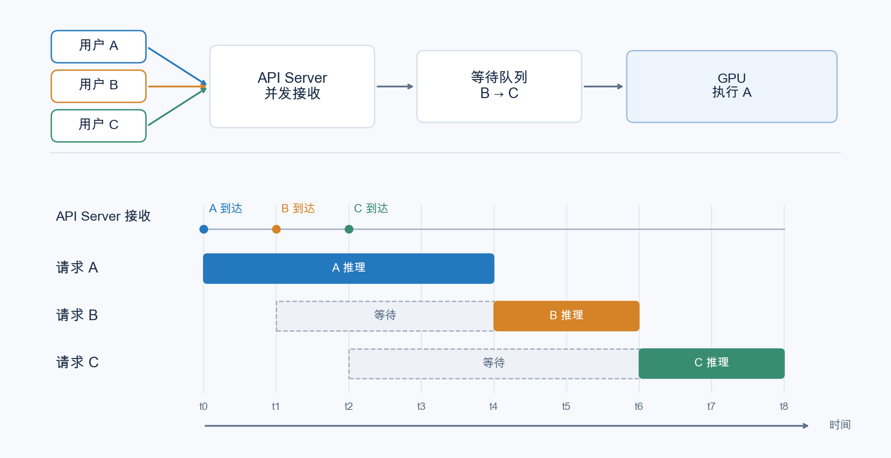
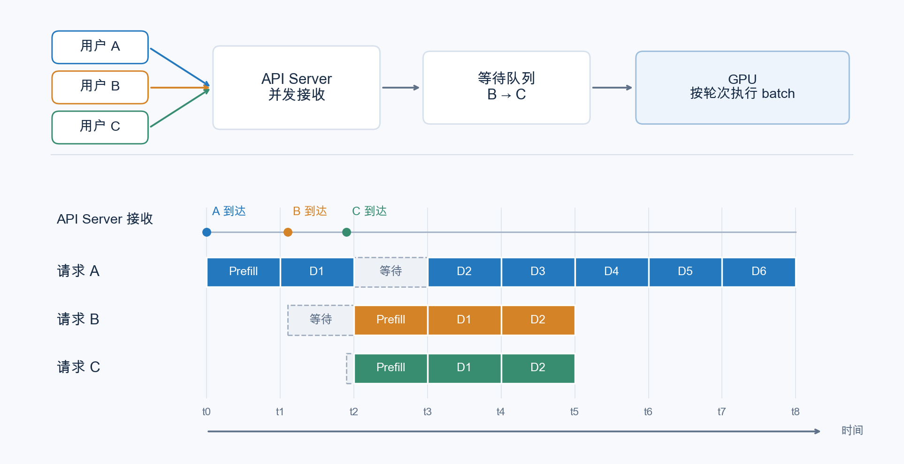

# 第 6 章 连续批处理与调度

上一章中，我们为推理引擎加上了 API Server，让推理引擎从一段用完就扔的程序升格为一个常驻内存的 HTTP 服务。上一章的第五节，我们提到了这个 API Server 需要支持多人同时访问，同时处理多个人请求（但是不考虑如何用 gpu 计算它们）也被我们称为“并发”。但是正如上一章第五节末尾所言，http 并发只是在逻辑层面处理接收不同的请求，这不等于并行执行多个请求的前向推理。

想要并行执行，最直接的做法就是把多个请求的解码后的 tokens 拼成一个 batch，然后以 batch 为单位进行前向计算，这样可以大幅增加 GPU 利用率，这也被我们称为批处理。而如何调度并发消费的用户请求，来让它们更加高效地被组织成用于执行批处理的 batch，并保证状态互不干扰，就是本章需要详细讨论的内容了。

## 1 本章学习目标

读完本章后，你应该能够解答如下的问题：

- 解释 API Server 并发和批处理并行的区别和解决的问题；
- 区分服务整体的输出吞吐量（token/s）与单用户生成速度（token/s/user），理解整体吞吐量提高不一定意味着每位用户的生成速度都提高；
- 通过静态批处理和连续批处理的性能差异，深刻理解连续批处理解决的问题；
- 理解连续批处理在迭代中更新请求集合的方式，以及 KV Cache 如何支持连续批处理；
- 描述请求选择、batch 组装、模型执行、状态更新和结束清理的基本流程；

## 2 从并发请求到批处理

### 2.1 用批处理提高系统吞吐

上一章中，API Server 已经能够在 A 等待生成结果时接收 B，并根据请求标识，将两人的结果分别送回各自的连接。但这只解决了服务层如何管理多个请求的问题，从程序层面支持多个用户同时请求我们的 mini-sglang API 服务。但是这并不意味着，我们的 GPU 会同时处理这些请求的 tokens，默认情况下，最为朴素的调度方式仍然是先计算请求 A 的前向，自回归完成后，返回结果给 A 用户，然后再去计算 B。

我们不妨看一个例子。

假设现在我们的 http 服务在短时间（比如 10 秒）内同时接收到了三个请求 A，B，C。我们的模型在对这些请求的 messages 进行前向的耗时有长有短，可能 A 的耗时最长（A 的 messages 可能是 computer use 帮你打明日方舟日常），B 和 C 的耗时最短（可能就是问一问杭州或者上海明天的天气）。我们在上一章完成的 API Server 会并发处理这三个请求的处理和调度，至少这么做会让发送这三个请求的用户在体感上觉得自己发送的大模型调用请求确实在被我们的推理引擎“处理”。

但是实际上，不做任何优化的最为朴素的调度模式下，推理引擎会顺序执行这三个请求的编码后的 tokens 的前向推理，如图 6.1 所示。

  
  
<em>图 6.1 并发接入与逐条推理的区别（未启用批处理的假设场景）</em>

图中可以看到，请求的处理和消费确实是并发的，但是由于实际让 GPU 执行推理时，前向推理是一个个来的，那么我相信，用户 C 的体验会非常糟糕，用户 C 的首 token 延迟（TTFT）等于用户 A 和用户 B 前向推理的总耗时。这不禁会让用户 C 在发送第一个请求后就立刻联系客服要求取消 code plan 的订阅。哦不，我的朋友，这很不好。

如果你很熟悉 PyTorch，我想大概能立刻想到优化方案：既然大模型的一次前向本质就是一堆的线性层和 matmul，那么我们把 A，B，C 三个用户的请求塞到一起不就能并行计算了吗？毕竟在模型算子角度，这三次请求本质就是三个不断执行的若干个线性层计算，且每一次执行线性层计算时，batch_size 都是 1。那么我们想办法把不同请求同时塞进去，让 batch_size 等于 3，不就能实现并行同时推理这三个请求了吗？这样，我们就可以充分发挥 GPU 并行计算的能力，服务更多的用户。

具体的一个调度示意图如图 6.2 所示：

  
  
<em>图 6.2 并发接入与批处理推理</em>

图 6.2 展示了当前 mini-sglang 在资源充足时的一种可能执行顺序，忽略 CPU/GPU 重叠调度的细节，时间间隔仅为示意。A 到达后就开始 Prefill，不等待其他请求凑批。B、C 在 A 的 D1 已经提交后到达，并且在下一次收集消息时都已准备好，因此在 t2 一起进行 Prefill；B 的等待是等待后续调度机会，而不是等待凑满 batch 或某个组批计时器超时。

当前 Scheduler 优先选择可执行的 Prefill batch，因此 t2 到 t3 期间 GPU 处理 B、C 的输入，A 暂时不进行下一轮 Decode，但它的历史 KV Cache 仍然保留。随后 A、B、C 组成 Decode batch，各自推进一步：A 执行 D2，B、C 执行 D1。不同请求不需要处于相同的自回归轮数。若下一次收集消息时只有 B 到达，就可以先处理 B，无须等待 C；若请求槽位、token 预算或 KV Cache 容量不足，则未被接纳的请求继续排队。

笔者拿 qwen3.8 27b 在 8 张 H200 上用 sglang 的默认配置跑了一下 bs=1 和 bs=16 的情况，下面是运行结果：

> 趣闻：deepseek r1 刚刚开源那会儿，很多云服务商都部署了开源版本的 deepseek r1，但是运行成本居高不下，一直达不到 deepseek 对外声称的 30% 毛利率，导致大量质疑 deepseek 数据造假的帖子层出不穷。后来 deepseek 揭秘了 30% 毛利率的 infra 工程技巧，其中最为关键的技巧就是批处理技术，根据笔者当年掌握的业界情报，峰值 batch size 至少为 8 的批处理推理引擎才能让 deepseek r1 的部署回本。想要达到 30% 的利润率，需要更大的 batch size 和更加精细化的 infra 调优。

想法很不错，但是其中有大量的技术细节需要在本章中讨论：

- 怎么调度才能让多个用户的请求在 PD 分离的框架下被并行计算？
- KV Cache 怎么管理？
- 假设我们最大 batch_size 为 16，但是有人一下子打过来 1000 条请求（比如友商友善蒸馏我们的模型），我们要如何处理它们的调度优先级？

在 mini-sglang 中，这些部分都通过 Scheduler 模块来进行负责，具体代码实现我们会在本章的代码走读环节进行。本章更多从概念角度为阁下答疑解惑。

让我们一个个来吧。

### 2.2 批处理怎样提高计算效率

多个请求使用的是同一份模型权重，因此可以将它们组织成一个 batch，在一次模型执行中共同推进。以 Decode 为例，如果 A、B 都已经完成 Prefill，那么一次批处理可以分别读取两人的历史 KV Cache，处理各自当前的一个 token，并为每条请求预测下一个 token，而不必先执行完 A 的整段回答再处理 B。

相比逐条执行，批处理让一次模型执行处理更多 token，有机会在多个请求之间复用读入的模型权重，并摊薄计算内核启动等开销，从而提高 GPU 利用率和整体吞吐量。不过，batch 越大，需要的计算与 KV Cache 空间也越多，因此批处理并不保证每条请求的延迟都会降低。

这里的“组成一个 batch”也不是把不同用户的文本拼成同一段上下文。每条请求仍然保留独立的序列位置、KV Cache 映射和生成参数，A 的注意力计算不会因此读取 B 的上下文。接下来的问题是：请求会在不同时间到达，也会在不同时间结束，这个 batch 应该怎样随之变化？

## 3 从静态批处理到连续批处理

### 3.1 静态批处理怎样组织请求

### 3.2 请求长度不同会带来什么问题

### 3.3 连续批处理怎样在迭代之间更新 batch

## 4 Prefill 与 Decode 怎样参与调度

### 4.1 两个阶段的计算特点有什么不同

### 4.2 新请求怎样从 Prefill 进入 Decode

### 4.3 Prefill 与 Decode 怎样安排执行顺序

## 5 调度器怎样组织一次迭代

### 5.1 管理等待请求与运行中的请求

### 5.2 根据 token 预算与 KV Cache 容量选择请求

### 5.3 组装 batch 并交给 engine 执行

### 5.4 更新请求状态，处理结束与取消

## 6 怎样评估调度效果

### 6.1 吞吐量与请求延迟怎样衡量

### 6.2 batch 大小与调度策略怎样影响性能

### 6.3 怎样比较静态批处理与连续批处理

## 7 总结与测试题

### 7.1 课程总结

### 7.2 测试题

## 参考资料
